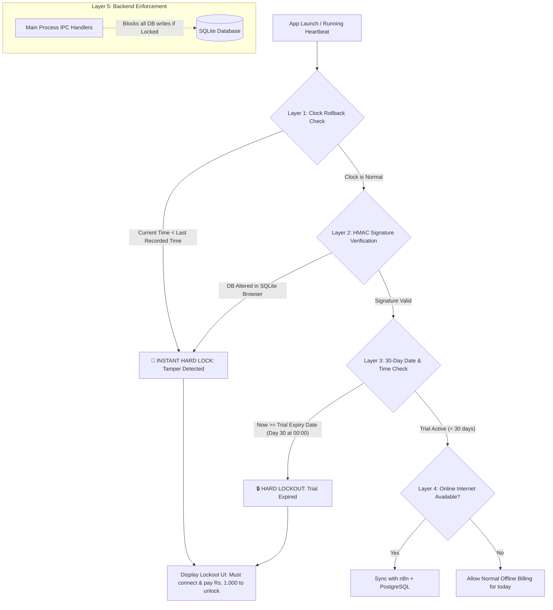

# Subscription & 30-Day Lockout System: Implementation Plan (PostgreSQL + Offline Defense Edition)

## 1. The Offline Problem & 5-Layer Defense Architecture

> **The Question:** What if a user takes their computer completely offline for the entire 30 days, or on Day 29 sets their Windows computer clock backwards to Day 1 to get unlimited free access?

To guarantee that **on Day 30 at 00:00, the user CANNOT use the application until payment is made**, we implement a **5-Layer Defense Architecture**:



---

## 2. The 5 Layers of Offline Protection

### Layer 1: Clock-Rollback Detection (Anti-Time Manipulation)
- Every 60 seconds while the app is open, and on every transaction, the app records the current Unix timestamp into an encrypted field: `last_recorded_local_time`.
- On startup and before every operation:
  ```ts
  if (currentSystemTime < last_recorded_local_time - 60) {
    // User set their Windows clock back to an earlier date/time!
    flagTamper('CLOCK_ROLLBACK_DETECTED')
    lockApplicationImmediately()
  }
  ```
- If the user sets their clock back from Nov 24 to Oct 26, the app detects that `Oct 26 < Nov 23` and **immediately shuts down and locks permanently** until verified online.

### Layer 2: Tamper-Sealed SQLite Signature (HMAC Hash)
- What if a user opens `inventory.db` using *DB Browser for SQLite* and manually edits the `trial_ends_at` date?
- The app stores a cryptographic signature:
  ```
  license_signature = HMAC_SHA256(machine_id + trial_ends_at + status, SECRET_SALT)
  ```
- If someone edits the table directly, the signature no longer matches the data. The app invalidates the license and locks immediately.

### Layer 3: Strict Day 30 Local Expiry
- When the user registers on Day 1, the local SQLite database permanently sets:
  - `registered_at`: `2026-10-25 13:30:00`
  - `trial_ends_at`: `2026-11-24 00:00:00` (Day 30, exactly at 00:00)
- The main process checks:
  ```ts
  if (status === 'Trial' && new Date() >= new Date(trial_ends_at)) {
    // 30 days elapsed!
    lockApplication('TRIAL_EXPIRED')
  }
  ```
- **Even with ZERO internet connection for the entire month**, on Day 30 at 00:00, this local check triggers without needing any external server.

### Layer 4: Mandatory Online Re-connection to Pay
- On Day 30, when the app locks:
  - It displays the Lockout Screen.
  - To pay ₹1,000 and unlock, the customer's computer must connect to the internet (or mobile hotspot) so that the payment gateway / n8n can verify the transaction and send the `Paid` signal.
  - Once internet connects and payment is confirmed in your PostgreSQL database, the app receives the `Paid` status, extends `paid_until` by +30 days, updates the local HMAC signature, and unfreezes.

### Layer 5: IPC-Level Database Shielding
- Even if a tech-savvy user tries to delete the Lockout modal via developer tools or CSS:
  - The actual database queries (`submit-transaction`, `add-product`, `view-records`) execute in the **Node.js Electron Main Process** ([app/src/main/index.ts](file:///h:/Inventory-Management-System/app/src/main/index.ts)).
  - Every IPC handler checks `isSubscriptionValid()` before touching SQLite. If locked, the call rejects immediately with an error, preventing any billing or data access.

---

## 3. PostgreSQL Master Schema (`client_subscriptions`)

Run this in your PostgreSQL database:

```sql
CREATE TABLE IF NOT EXISTS client_subscriptions (
    id SERIAL PRIMARY KEY,
    machine_id VARCHAR(100) UNIQUE NOT NULL,
    full_name VARCHAR(255) NOT NULL,
    business_name VARCHAR(255) NOT NULL,
    contact_no VARCHAR(50) NOT NULL,
    registered_at TIMESTAMP WITH TIME ZONE DEFAULT CURRENT_TIMESTAMP,
    payment_status VARCHAR(20) DEFAULT 'Trial', -- 'Trial', 'Pending', 'Paid'
    date_of_payment TIMESTAMP WITH TIME ZONE,
    trial_ends_at TIMESTAMP WITH TIME ZONE NOT NULL,
    paid_until TIMESTAMP WITH TIME ZONE,
    current_subscription_price NUMERIC(10, 2) DEFAULT 1000.00,
    tamper_flag BOOLEAN DEFAULT FALSE,
    notes TEXT,
    created_at TIMESTAMP WITH TIME ZONE DEFAULT CURRENT_TIMESTAMP,
    updated_at TIMESTAMP WITH TIME ZONE DEFAULT CURRENT_TIMESTAMP
);

CREATE INDEX IF NOT EXISTS idx_client_subscriptions_machine_id ON client_subscriptions(machine_id);
```

---

## 4. Local SQLite Table in Electron (`app_user_registration`)

Added to `initDb()` in [app/src/main/index.ts](file:///h:/Inventory-Management-System/app/src/main/index.ts):

```sql
CREATE TABLE IF NOT EXISTS app_user_registration (
  id INTEGER PRIMARY KEY CHECK (id = 1),
  machine_id TEXT NOT NULL,
  full_name TEXT NOT NULL,
  business_name TEXT NOT NULL,
  contact_no TEXT NOT NULL,
  registered_at DATETIME NOT NULL,
  payment_status TEXT DEFAULT 'Trial',
  trial_ends_at DATETIME NOT NULL,
  paid_until DATETIME,
  current_price REAL DEFAULT 1000,
  last_recorded_local_time INTEGER NOT NULL,
  license_signature TEXT NOT NULL,
  tamper_detected INTEGER DEFAULT 0
);
```

---

## 5. Next Steps for Implementation

1. **Machine ID & Cryptographic Sealer**:
   - Hardware UUID generator in Node.js.
   - HMAC-SHA256 signature generator to seal trial timestamps.
2. **Clock Rollback Guard**:
   - Background ticker saving local timestamp every 60s.
3. **Registration Modal**:
   - Clean first-launch popup collecting Name, Business, Phone.
4. **Day 30 Lockout Screen**:
   - Hard lock modal preventing access on `now >= trial_ends_at` or `payment_status === 'Pending'`.
