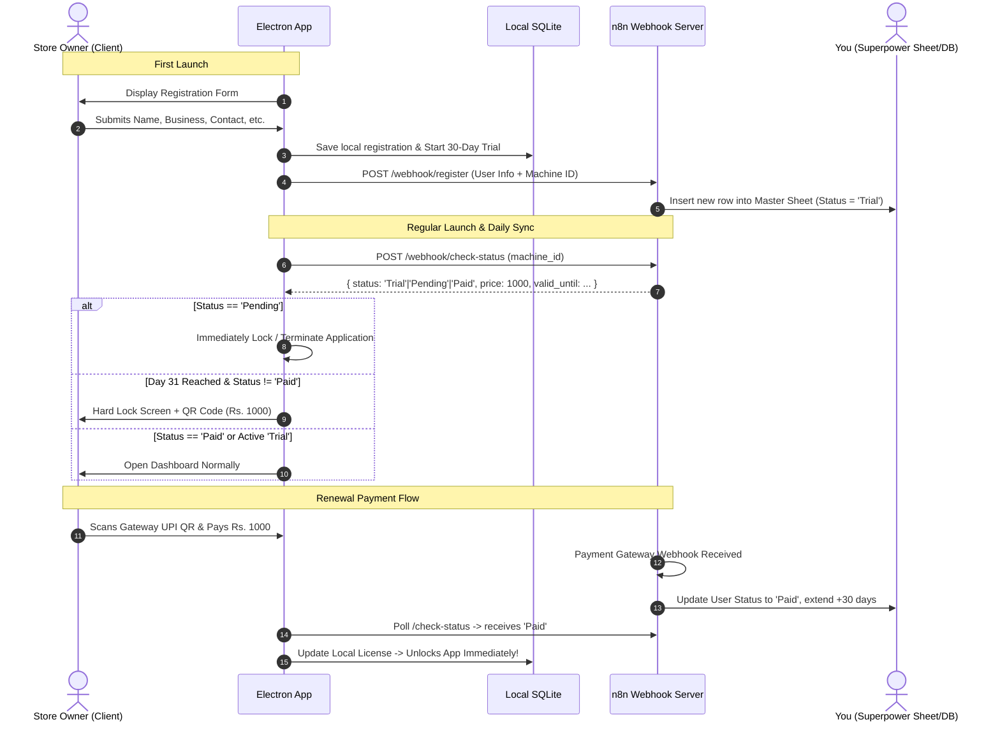

# Subscription & 30-Day Lockout System: Implementation Plan (n8n Edition)

## 1. Overview & Architecture

This plan implements a **30-day recurring subscription lockout system** powered by an **n8n workflow backend**, giving the admin an interactive "superpower table" (Google Sheets / Airtable / PostgreSQL via n8n) to monitor, price, and control client access in real time.



---

## 2. User Registration Form (First Install)

When the application is installed for the first time, it greets the store owner with a sleek, branded **One-Time Registration Modal** before granting access:

### Registration Form Fields:
1. **User Full Name**: (Required) Store owner/operator name.
2. **Business / Store Name**: (Required) e.g., "Addy's Studio".
3. **Contact / WhatsApp Number**: (Required) 10-digit phone number.
4. **City / Location**: (Optional) For vendor/store categorization.
5. **Registration Date**: Automatically captured timestamp (`new Date().toISOString()`).
6. **Machine ID**: Automatically generated hardware fingerprint.
7. **Initial Payment Status**: Default set to `Trial` (grants 30 days access).
8. **Trial Expiry Date**: `Registration Date + 30 days` at 00:00.

---

## 3. The 3 Subscription States ("Your Superpower")

You control the entire ecosystem from your n8n master table via three definitive states:

| Status | Meaning | App Behavior |
| :--- | :--- | :--- |
| **`Trial`** | Initial 30-day free trial active. | The app runs normally. Shows days remaining (`X days left in trial`). Exactly on **Day 31 at 00:00**, it immediately switches to Hard Lockout. |
| **`Pending`** | Payment due, expired, or access revoked by admin. | **Immediately shuts down / blocks the application**. Displays the payment lockout screen with dynamic QR (Rs. 1,000) and blocks all navigation. |
| **`Paid`** | Active subscription paid and verified. | The app runs seamlessly without restrictions for the next 30 days. |

---

## 4. Remote Price Control (`current_subscription_price`)

- **Default Price**: `Rs. 1,000`.
- **Admin Control**: The subscription price is **NOT hardcoded** in the client app. Instead:
  - It is delivered dynamically by your n8n backend in the `/check-status` response payload:
    ```json
    {
      "status": "Trial",
      "current_subscription_price": 1000,
      "valid_until": "2026-11-24T00:00:00.000Z"
    }
    ```
  - **You are the only one who can change it**: By simply updating the price variable in your n8n workflow or master sheet, any client opening the app will automatically see the new price on their renewal QR code.
  - A fallback default (`1000`) is kept in local encrypted storage in case the app boots completely offline.

---

## 5. n8n Webhook Endpoints Specification

Your n8n instance will expose 3 simple webhooks:

### 1. `POST /webhook/app-register`
- **Triggered By**: Client on first registration submission.
- **Request Body**:
  ```json
  {
    "machine_id": "a1b2c3d4-e5f6-7890",
    "full_name": "Aashish Kaaley",
    "business_name": "Addy's Studio",
    "contact_no": "+91 98765 43210",
    "registered_at": "2026-10-25T13:00:00Z",
    "trial_ends_at": "2026-11-24T00:00:00Z",
    "payment_status": "Trial",
    "app_version": "1.1.4"
  }
  ```
- **n8n Action**: Appends a row to your Google Sheet / Airtable / Supabase database.
- **Response**: `{ "success": true, "message": "Registered successfully" }`

### 2. `POST /webhook/check-status`
- **Triggered By**: Client on app startup and every 30 minutes in background.
- **Request Body**: `{ "machine_id": "a1b2c3d4-e5f6-7890" }`
- **n8n Action**: Looks up row by `machine_id`.
- **Response**:
  ```json
  {
    "registered": true,
    "payment_status": "Trial", // "Trial" | "Pending" | "Paid"
    "valid_until": "2026-11-24T00:00:00Z",
    "current_subscription_price": 1000,
    "announcement": null
  }
  ```

### 3. `POST /webhook/payment-gateway-callback`
- **Triggered By**: Payment Gateway (Razorpay / Cashfree) when customer pays Rs. 1,000.
- **n8n Action**:
  - Matches payment `order_id` / `machine_id`.
  - Updates status in your sheet to `Paid`.
  - Sets `valid_until` = `current_date + 30 days`.
  - Sends a WhatsApp / Email receipt to the user (optional n8n node!).

---

## 6. Local SQLite & Offline Resilience Schema

In [app/src/main/index.ts](file:///h:/Inventory-Management-System/app/src/main/index.ts), we store the client-side state in a dedicated table:

```sql
CREATE TABLE IF NOT EXISTS app_user_registration (
  id INTEGER PRIMARY KEY CHECK (id = 1),
  machine_id TEXT NOT NULL,
  full_name TEXT NOT NULL,
  business_name TEXT NOT NULL,
  contact_no TEXT NOT NULL,
  registered_at DATETIME NOT NULL,
  payment_status TEXT DEFAULT 'Trial', -- 'Trial', 'Pending', 'Paid'
  date_of_payment DATETIME,
  trial_ends_at DATETIME NOT NULL,
  paid_until DATETIME,
  current_price REAL DEFAULT 1000,
  last_online_sync DATETIME,
  last_system_clock DATETIME NOT NULL,
  tamper_detected INTEGER DEFAULT 0
);
```

### Clock-Tampering Guard (Anti-Rollback):
- Every minute the app runs, `last_system_clock` is updated.
- If a user changes their Windows PC clock backward to stay in the 30-day window (`new Date() < last_system_clock`), the app detects clock tampering, immediately enters `Pending` state, and locks until synced with n8n server time.

---

## 7. Lockout Screen UI (`SubscriptionLockoutModal.tsx`)

On Day 31 at 00:00 (or if status is `Pending`):
1. **Full-screen Modal**: Dark glassmorphic backdrop covering 100% of the viewport.
2. **Lock Icon & Header**:
   - *"Monthly Subscription Renewal Required"*
   - Store Name: *"Addy's Studio"* | Machine ID: `XXXX-XXXX`
3. **Price Tag**: **₹1,000 / month** (dynamically loaded from n8n).
4. **Automated UPI Payment QR**:
   - Generates dynamic payment QR code with gateway transaction reference.
   - Shows live polling spinner: *"Waiting for payment confirmation... (Auto-unlocks instantly)"*.
5. **Instant Unlock Event**:
   - As soon as n8n acknowledges payment, the modal triggers a success sound, green checkmark, and unlocks the dashboard.

---

## 8. Implementation Steps & Milestones

1. **Step 1: Machine ID & SQLite Registration Storage**
   - Implement persistent hardware UUID generator in Electron main process.
   - Create `app_user_registration` table in `initDb()`.
2. **Step 2: Registration Modal in Renderer**
   - Create `UserRegistrationModal.tsx` shown if user is not registered.
   - Saves locally and dispatches webhook to n8n.
3. **Step 3: n8n Sync Service & Background Poller**
   - Create `n8nService.ts` in Electron main process to check `/check-status` on startup and hourly.
4. **Step 4: Lockout Component & Route Blocker**
   - Create `SubscriptionLockoutModal.tsx` triggered when `status === 'Pending'` or `now >= trial_ends_at`.
   - Prevent all IPC actions (`submit-transaction`, etc.) when locked.
5. **Step 5: Payment Gateway Webhook Connection**
   - Connect the payment gateway to n8n and test instant unlock flow.
