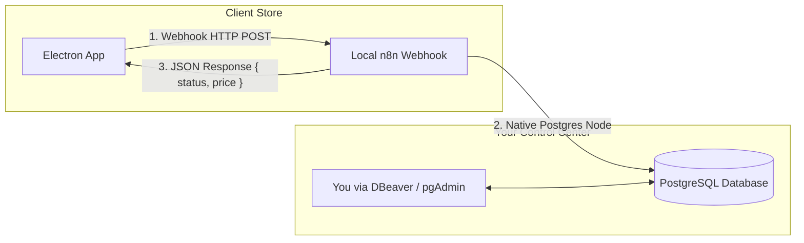

# Subscription & 30-Day Lockout System: Implementation Plan (PostgreSQL + Local n8n Edition)

## 1. Architecture Overview

In this setup:
- **Your Superpower Table**: A local/remote **PostgreSQL** database where you can directly view, update, query, and edit client records using **pgAdmin, DBeaver, or psql**.
- **Backend Hub**: An **n8n workflow** running on your PC that connects the incoming webhooks directly to your **PostgreSQL** database node and responds back to the client app.
- **Client App**: The Electron application running on the store computer.



---

## 2. PostgreSQL Superpower Table Schema

You can directly run this SQL script in your PostgreSQL database to create your master table:

```sql
CREATE TABLE IF NOT EXISTS client_subscriptions (
    id SERIAL PRIMARY KEY,
    machine_id VARCHAR(100) UNIQUE NOT NULL,
    full_name VARCHAR(255) NOT NULL,
    business_name VARCHAR(255) NOT NULL,
    contact_no VARCHAR(50) NOT NULL,
    registered_at TIMESTAMP WITH TIME ZONE DEFAULT CURRENT_TIMESTAMP,
    payment_status VARCHAR(20) DEFAULT 'Trial', -- 'Trial', 'Pending', 'Paid'
    date_of_payment TIMESTAMP WITH TIME ZONE,
    trial_ends_at TIMESTAMP WITH TIME ZONE NOT NULL,
    paid_until TIMESTAMP WITH TIME ZONE,
    current_subscription_price NUMERIC(10, 2) DEFAULT 1000.00,
    notes TEXT,
    created_at TIMESTAMP WITH TIME ZONE DEFAULT CURRENT_TIMESTAMP,
    updated_at TIMESTAMP WITH TIME ZONE DEFAULT CURRENT_TIMESTAMP
);

-- Index for instant lookup by machine ID
CREATE INDEX IF NOT EXISTS idx_client_subscriptions_machine_id ON client_subscriptions(machine_id);
```

### How You Control Access in PostgreSQL:
- **Lock Out Immediately**: Set `payment_status = 'Pending'` for a user. The moment their app syncs, it locks down.
- **Grant Paid Extension**: Set `payment_status = 'Paid'` and `paid_until = NOW() + INTERVAL '30 days'`.
- **Change Monthly Price**: Update `current_subscription_price = 1200.00`. The client's QR code will immediately reflect ₹1,200 instead of ₹1,000.

---

## 3. n8n Workflow Design (Simple 2-Step Nodes)

### Workflow 1: User Registration
```
[Webhook Node (POST /app-register)]
      ↓
[Postgres Node: INSERT INTO client_subscriptions]
  - Values: machine_id, full_name, business_name, contact_no, trial_ends_at (NOW + 30 days), payment_status ('Trial')
      ↓
[Respond to Webhook Node: { "success": true, "status": "Trial" }]
```

### Workflow 2: Subscription Status Check & Sync
```
[Webhook Node (POST /check-status)]
      ↓
[Postgres Node: SELECT * FROM client_subscriptions WHERE machine_id = $json.machine_id]
      ↓
[Respond to Webhook Node: 
  {
    "registered": true,
    "payment_status": $json.payment_status,
    "current_subscription_price": $json.current_subscription_price,
    "trial_ends_at": $json.trial_ends_at,
    "paid_until": $json.paid_until
  }
]
```

---

## 4. User Registration Form in Electron App

Appears on fresh installation if no local registration is found:
- **Fields**:
  - Full Name (required)
  - Business Name (required)
  - Contact No / WhatsApp (required)
  - Auto-generated: Registration Date (`NOW`), Machine ID (hardware UUID), Initial Status (`Trial`).
- Once submitted, the app saves locally in SQLite and sends the registration payload to your n8n webhook.

---

## 5. Client Status Rules & Lockout

1. **`Trial`**:
   - The user gets full access for 30 days from registration date.
   - On **Day 31 at 00:00**, it immediately hard-locks and requires payment.
2. **`Pending`**:
   - **Immediately locks/closes the application**. Shows the dynamic payment QR (Rs. 1,000) and halts all billing and records.
3. **`Paid`**:
   - Unlocks the app and operates normally until `paid_until`.

---

## 6. Implementation Plan Next Steps

- **Step 1**: Implement SQLite schema in `app/src/main/index.ts` to cache registration, machine ID, and subscription state locally for offline resilience.
- **Step 2**: Build the `UserRegistrationModal.tsx` in React for new installs.
- **Step 3**: Build `SubscriptionLockoutModal.tsx` for `Pending` / expired `Trial` states.
- **Step 4**: Add n8n sync service in Electron main process pointing to your n8n webhook URL.
